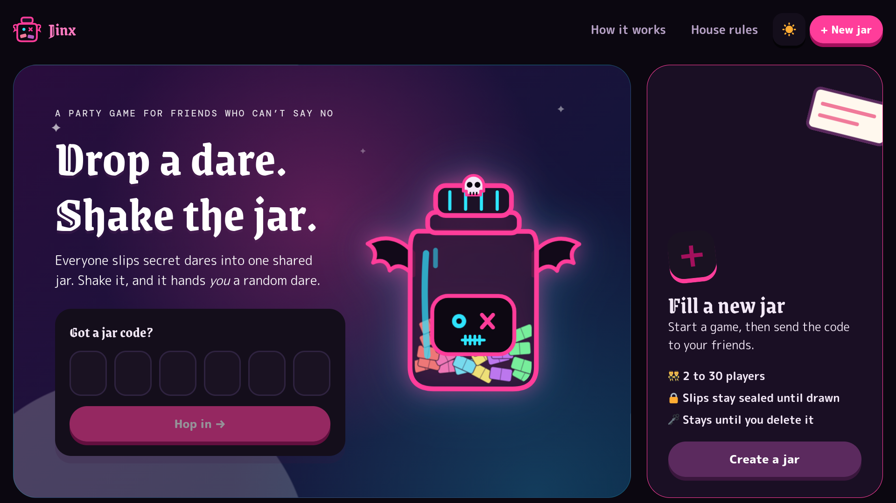

# Jinx - gives random dare

A dare game for friends. Everyone secretly adds dares, then shakes the jar to get a random one.

## How to play

1. **Create a jar.** Click **New jar**, give it a name and a sticker, choose how many players (2–30), and set the rules.
2. **Invite friends.** Share the 6-letter code or the invite link.
3. **Join.** Friends enter the code on the home page, then pick a name and an animal avatar.
4. **Add dares.** Type a dare and press Enter. Only you can see your dares until one is drawn.
5. **Shake the jar.** Whoever shakes gets a random dare from someone else. Everyone sees it pop up.
6. **Choose what happens.**
   - ✅ **Done it**: +2 points
   - 🐔 **Chicken out**: −1 point

   Either way the dare goes back in the jar, so it can come up again.
   - 🚫 **Veto**: the dare is removed forever (needs two players, or the host)
   - 🔄 **Draw another**: picks a new dare (host or the chosen player only)

## Playing on a video call

- The slips you've already dropped in the jar are hidden by default, so sharing your screen gives nothing away. Click **Show my slips** to see them.
- While a dare is on screen the jar fills the whole screen. Click **Small screen** to bring the side panel back, or **Big screen** to enlarge it anytime.

## Changing a result

Open **History** and click ✏️ on a dare to change its result (for example, from Chickened out to Done). The host or the player who got the dare can do this, and scores update automatically.

## Host controls

Open the ⚙️ menu to lock the jar, make a new code, remove players, add ready-made dare packs, end the game, or delete the jar.

Jars are kept until the host deletes them.

## Light and dark mode

Use the 🌙 / ☀️ button: light mode is cute and bright, dark mode is gothic.
